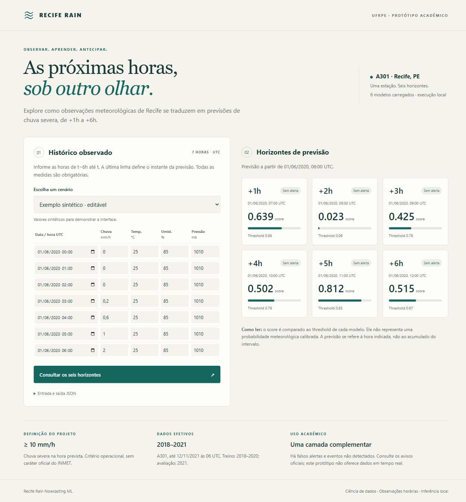

# Previsão de chuva severa em Recife com aprendizado de máquina

## Resumo

**Metodologia temporal, resultados científicos e desenvolvimento de uma aplicação**

Projeto: recife-rain-nowcasting-ml. Contexto acadêmico: Universidade Federal Rural de Pernambuco (UFRPE). Versão documental: 13 de outubro de 2026. A composição e a atribuição formal de autoria do grupo de pesquisa ainda precisam ser confirmadas antes de uma submissão acadêmica.

Este artigo consolida a documentação científica e técnica disponível do projeto Recife Rain Nowcasting ML, que investiga a previsão de chuva severa a partir de observações horárias da estação automática A301 do Instituto Nacional de Meteorologia (INMET), em Recife, Pernambuco. O período efetivamente utilizável vai de 1º de janeiro de 2018, às 00 UTC, a 12 de novembro de 2021, às 06 UTC. A tarefa consiste em seis classificações binárias independentes, de +1h a +6h, com definição operacional de chuva severa igual ou superior a 10 mm/h. Utilizam-se 20 atributos derivados exclusivamente de observações presentes e passadas, Regressão Logística e Random Forest, validação temporal expansiva anterior a 2021 e thresholds selecionados com previsões fora da amostra de validação. Uma auditoria identificou rótulos que atravessavam fronteiras temporais; a correção autorizada exigiu repetir a seleção e preservar os resultados antigos como histórico. O modelo principal de +1h apresentou precisão de 0,170, recall de 0,447, F1 de 0,246 e Average Precision de 0,225 no teste de 2021. A análise não supervisionada identificou três regimes meteorológicos, sem uso do alvo na formação dos clusters. O desenvolvimento de software produziu treinamento reproduzível, seis artefatos serializados, inferência, validação de entradas, ambiente com versões fixadas, 38 testes automatizados e um protótipo web local. A aplicação ainda recebe entradas manuais ou históricas. O objetivo de operar nos dias atuais depende da integração e da validação de observações recentes da mesma estação, etapa que permanece pendente. [R1-R8]

**Palavras-chave:** chuva severa; nowcasting; INMET; classificação desbalanceada; validação temporal; aprendizado supervisionado; clustering; aplicação web.

**Nota de leitura:** os resultados vigentes são os da correção temporal aprovada em 11/10/2026. Tabelas antigas dos notebooks e figuras científicas anteriores permanecem históricas. Este artigo não introduz novos modelos, dados ou decisões metodológicas. As tabelas de desempenho apresentadas foram extraídas dos CSVs corrigidos, e não das figuras antigas.

## 1. Introdução e objetivo do projeto

A proposta do projeto é transformar observações meteorológicas em informação sobre chuva nas próximas horas, utilizando aprendizado de máquina e uma aplicação acessível. A investigação se concentra em uma estação de superfície, A301, Recife. Essa delimitação é importante: o modelo aprende relações presentes nos dados da estação e não oferece, por si só, cobertura espacial detalhada de toda a cidade. [R1-R3]

O objetivo final é permitir que a aplicação receba observações recentes do INMET e apresente previsões para o presente operacional. Os dados históricos de 2018 a 2021 foram usados para construir, selecionar e avaliar os modelos; não representam uma exigência de que o aplicativo faça apenas consultas ao passado. Após o treinamento, o mesmo modelo pode processar uma nova janela de medições, desde que a estação, as unidades, a periodicidade e as fórmulas de atributos sejam compatíveis com o contrato validado.

Há três etapas distintas: pesquisa histórica, inferência com modelos já treinados e operação com alimentação automática de dados recentes. A primeira está concluída; a segunda está implementada e demonstrável; a terceira ainda depende de integração. O protótipo atual comprova o caminho entre observações fornecidas, atributos, seis modelos e visualização dos resultados. Ele ainda não comprova disponibilidade contínua de dados atuais nem desempenho em condições meteorológicas posteriores a 2021. [R5-R8]

As perguntas de pesquisa são: observações horárias de uma estação permitem antecipar eventos de chuva severa? Quais regimes meteorológicos aparecem nos dados? Como expor a saída dos modelos de forma compreensível e reproduzível em uma aplicação? O trabalho combina investigação supervisionada, análise não supervisionada e desenvolvimento de software, mantendo papéis distintos para cada componente.

### 1.1 Aprendizado supervisionado e não supervisionado

Na etapa supervisionada, cada exemplo histórico possui atributos disponíveis em t e um rótulo construído com a chuva observada em t+h. Durante a inferência real, o rótulo futuro é desconhecido; o modelo utiliza apenas os atributos para estimá-lo. A expressão “chuva ainda não observada” descreve o fenômeno futuro a prever, não uma segunda base obrigatória para treinamento.

Na etapa não supervisionada, K-Means agrupa estados meteorológicos sem utilizar o rótulo de chuva severa durante a formação dos grupos. A análise revela padrões descritivos. Os clusters não são atualmente usados como atributos dos seis classificadores, não constituem um segundo sistema de previsão e não sustentam conclusões causais. Incorporá-los à inferência seria uma mudança metodológica adicional, que exigiria avaliação e autorização. [R1-R3]

### 1.2 Escopo da previsão

O alvo vigente é chuva severa na hora t+h, de +1h até +6h. O sistema não estima a quantidade exata de precipitação, qualquer ocorrência de chuva leve, acumulados de seis horas ou previsão diária para os próximos dias. Esses objetivos podem motivar trabalhos posteriores, mas requerem outros alvos e validação. O projeto é uma abordagem complementar e acadêmica, sem equivalência com um sistema meteorológico oficial.

## 2. Dados, auditoria e disponibilidade

A fonte institucional das observações é o INMET. O portal oficial oferece acesso a arquivos históricos anuais de estações automáticas, mas a existência desses pacotes não garante que uma estação específica tenha medições válidas em todos os anos. A disponibilidade efetiva usada neste projeto foi definida pela inspeção dos arquivos e pela auditoria registrada no repositório. [R2, R3, R9]

O escopo acadêmico inicial abrangia 2018-2024. Entretanto, as principais variáveis meteorológicas da A301 estavam indisponíveis nos arquivos de 2022 e 2023 inspecionados. A301/Recife não foi encontrada no pacote histórico oficial de 2024 examinado, nem no arquivo de 2024 da fonte secundária mencionada no handoff. Isso não demonstra que a estação estivesse inativa: demonstra a limitação dos materiais inspecionados. Nenhuma estação alternativa foi introduzida. [R1-R3]

Em 2021, a última observação com os campos meteorológicos centrais completos ocorreu em 12/11/2021, às 06 UTC. A grande lacuna contínua posterior começa às 07 UTC desse dia e se estende até o fim do ano nos dados auditados. O recorte efetivo foi, portanto, limitado a 2018-01-01 00:00 UTC até 2021-11-12 06:00 UTC. Lacunas internas permanecem explicitamente ausentes.

| Indicador antes dos filtros por horizonte | Quantidade |
|---|---:|
| Timestamps no recorte efetivo | 33.871 |
| Observações com precipitação medida | 33.302 |
| Observações sem precipitação medida | 569 |
| Horas sem chuva medida | 28.777 |
| Horas com chuva medida | 4.525 |
| Horas com precipitação >= 10 mm/h | 109 |
| Linhas com as 20 features completas | 32.881 |
| Linhas com alguma feature ausente | 990 |

Tabela 1. Contagens da auditoria documental. Completude das features: aproximadamente 97,08%. As 109 horas severas são medidas no estado corrente, antes dos filtros específicos de cada alvo; não são o número de positivos de cada divisão de treino e teste. Fonte: [R2, R3].

A taxa de chuva severa entre as observações com precipitação válida é aproximadamente 0,327%. Após os filtros por horizonte, o teste contém 38 positivos por horizonte e prevalência próxima de 0,525%. Esse desbalanceamento orienta tanto as métricas de avaliação quanto a interpretação dos alertas.

### 2.1 Preprocessamento e decisões sobre ausências

A sequência experimental contempla normalização de colunas, parsing de datas e horas, inspeção de duplicatas, continuidade horária, consolidação entre anos, engenharia de atributos e construção de alvos. A grade horária é essencial: deslocar uma linha só corresponde a uma hora quando a sequência temporal está devidamente representada e verificada. [R2, R3]

Ausência não significa precipitação zero. Não se preenchem medições ou alvos futuros automaticamente. Uma eventual imputação futura precisaria de justificativa metodológica e ajuste usando somente o treino. A aplicação segue essa decisão ao rejeitar históricos incompletos, em vez de completar valores silenciosamente.

Variáveis de vento foram investigadas e retiradas das features finais. Aproximadamente 46% das observações de vento no treino estavam ausentes; sua exigência reduzia a disponibilidade de linhas completas e excluía cerca de 27-30 eventos severos de treino, conforme o horizonte. A decisão preservou amostras raras sem criar valores artificiais. [R1, R2]

### 2.2 Proveniência ainda incompleta

O repositório identifica instituição, estação, resolução e período efetivo. Ainda faltam os endereços exatos dos downloads originais, datas de acesso, nomes dos arquivos brutos e notas de uso/licenciamento. O endereço público do INMET citado neste artigo é uma referência institucional consultada; não substitui a cadeia de proveniência dos arquivos utilizados. Dados brutos e processados permanecem ignorados pelo Git. [R3]

## 3. Definição do alvo e engenharia de atributos

Para cada horizonte h entre 1 e 6, o alvo é y_h(t)=1 quando a precipitação observada em t+h é maior ou igual a 10,0 mm/h, e y_h(t)=0 quando existe medição abaixo desse limite. Se a precipitação futura estiver ausente, o alvo permanece ausente. A definição de 10 mm/h é operacional e específica deste projeto, próxima do percentil 97,5 das horas chuvosas do recorte, conforme a documentação experimental. Não é uma classificação oficial do INMET. [R1, R2]

As features representam somente informações disponíveis até t. Medições em t+h existem apenas para construir e avaliar os rótulos históricos. Elas nunca entram na matriz de entrada dos classificadores. A lista de 20 campos e sua ordem são compartilhadas pelo treinamento e pela inferência por meio de src/features/schema.py. A relação completa está no Apêndice A.

| Grupo | Número de features | Conteúdo |
|---|---:|---|
| Estado meteorológico corrente | 4 | Chuva, temperatura, umidade e pressão na estação |
| Ciclos temporais em UTC | 4 | Seno/cosseno da hora e do dia do ano |
| Histórico de chuva | 6 | Lags de 1, 2, 3 e 6 horas; somas de 3 e 6 horas |
| Estado da hora anterior | 3 | Temperatura, umidade e pressão em t-1h |
| Variação de uma hora | 3 | Valor corrente menos valor em t-1h |

Tabela 2. Organização das 20 features vigentes. Fontes: [R1, R5, R6].

### 3.1 Fórmulas preservadas na aplicação

O ciclo horário usa seno e cosseno de 2*pi*hora_UTC/24. O ciclo anual usa seno e cosseno de 2*pi*dia_do_ano_UTC/365,25, mantendo a mesma fórmula inclusive nos anos bissextos. Os lags de precipitação acessam t-1h, t-2h, t-3h e t-6h. As somas móveis incluem o instante corrente: a soma de três horas usa t-2h, t-1h e t; a soma de seis usa t-5h até t. As diferenças meteorológicas são valor em t menos valor em t-1h. [R5, R6]

A construção causal precisa de pelo menos sete observações horárias consecutivas, de t-6h a t. O instante de previsão é a última observação fornecida. A função build_current_features aceita um DataFrame ou lista de registros, verifica o histórico inteiro e devolve somente a amostra mais recente. Não reamostra, não completa lacunas e não usa observações posteriores ao instante de previsão.

Timestamps precisam de fuso explícito, são normalizados para UTC e devem ser únicos, ordenados e alinhados a horas inteiras. Medições precisam ser numéricas, reais e finitas. Para a entrada manual, chuva deve ser não negativa, umidade deve estar entre 0 e 100 e pressão deve ser positiva. Essas verificações da interface não redefinem nem refiltram o conjunto científico já validado.

### 3.2 Responsabilidade por features preparadas

A API também aceita objetos com as 20 features prontas. Nessa modalidade, verifica nomes, completude, tipos, finitude e ordem, mas não pode provar que o cliente calculou os atributos com observações causalmente válidas. O construtor a partir de histórico é o caminho mais direto para preservar as fórmulas e a coerência temporal no aplicativo. [R5]

## 4. Validação temporal e correção de leakage

A avaliação final separa treino em 2018-2020 e teste em 2021. A seleção de modelos usa duas janelas expansivas: treino em 2018 e validação em 2019; treino em 2018-2019 e validação em 2020. Nenhuma divisão aleatória é utilizada na avaliação final. 2021 não participa da escolha de famílias, hiperparâmetros, thresholds, ajuste de scaler ou treinamento dos modelos finais. [R1, R2, R4]

O primeiro procedimento experimental dividia amostras pela hora de observação t. Isso permitia que as últimas h amostras de um período tivessem rótulos calculados com precipitação de um período seguinte reservado. Por exemplo, uma observação de 31/12/2020 às 23 UTC para +1h depende da chuva em 01/01/2021 às 00 UTC, fora do limite permitido para ajuste final.

A correção autorizada em 11/10/2026 exige, em cada uso de treino ou validação: início_da_partição <= t; t+h < fim_exclusivo_da_partição; e elegibilidade do horizonte verdadeira. O fim exclusivo do ajuste final é 2021-01-01 00:00 UTC. Assim, nem a observação nem o rótulo do ajuste final podem alcançar 2021. [R4]

| Uso da partição e fronteira auditada | +1h | +2h | +3h | +4h | +5h | +6h |
|---|---:|---:|---:|---:|---:|---:|
| Fold 1: treino 2018; fronteira 2018/2019 | 1 | 2 | 3 | 4 | 5 | 6 |
| Fold 1: validação 2019; fronteira 2019/2020 | 1 | 2 | 3 | 4 | 5 | 6 |
| Fold 2: treino 2018-2019; fronteira 2019/2020 | 1 | 2 | 3 | 4 | 5 | 6 |
| Fold 2: validação 2020; fronteira 2020/2021 | 1 | 2 | 3 | 4 | 5 | 6 |
| Treino final 2018-2020; fronteira 2020/2021 | 1 | 2 | 3 | 4 | 5 | 6 |

Tabela 3. Amostras removidas por uso da partição e horizonte. Zero positivos foram removidos em cada célula. Os usos têm janelas sobrepostas e não devem ser somados como observações únicas. Fontes: [R4], temporal_boundary_audit.csv. Contagens completas no Apêndice B.

Fronteiras internas de uma janela expansiva não precisam de exclusão quando os dois lados já pertencem ao mesmo treino. O objetivo da regra é impedir que o rótulo ultrapasse o fim do período autorizado para aquele ajuste ou aquela validação.

### 4.1 Por que foi necessário repetir a seleção

Remover apenas negativos ainda altera médias de padronização, ajuste de modelos, sorteios de bootstrap e ordenação de scores. Portanto, não seria metodologicamente correto manter automaticamente todos os thresholds e hiperparâmetros antigos. A seleção foi repetida com a mesma grade e o mesmo procedimento, usando somente os folds corrigidos anteriores a 2021.

Para Regressão Logística, C pertence a [0,01; 0,1; 1,0; 10,0]. Para Random Forest, max_depth pertence a [4; 8; None] e min_samples_leaf a [1; 10], com 300 árvores. Há 10 candidatos por horizonte, totalizando 60 configurações e 120 ajustes candidato/fold. A escolha de família e parâmetros maximiza a Average Precision média das duas validações. [R4]

Os thresholds são escolhidos pelas previsões OOF de 2019 e 2020 concatenadas, maximizando F1 na grade original de 0,01 a 0,99, em passos de 0,01. Empates usam recall e depois precisão; a ordem da grade resolve empates exatos de configuração em AP. As seis escolhas são congeladas antes da avaliação corrigida de 2021.

### 4.2 Transparência do histórico experimental

O notebook antigo continha também uma classificação de famílias por F1 do teste de 2021, que não é adequada para seleção. A implementação corrigida explicita a seleção pela AP pré-2021 e registra evidência sem arredondamento. O teste corrigido é uma reavaliação de um holdout histórico já inspecionado, não uma nova amostra independente coletada após a correção. [R4]

Os CSVs antigos foram preservados byte a byte em docs/validation/history/. Os notebooks e suas saídas continuam como evidência histórica, com indicação dessa condição. Resultados científicos corrigidos são arquivos separados. A comparação combina exclusão nas fronteiras e reseleção; não isola um efeito causal de cada linha removida.

## 5. Configurações finais e métricas

As configurações vigentes estão em docs/validation/validated_configurations.json. Esse arquivo é a fonte única de escolhas para o treinamento reproduzível. Há um classificador binário independente por horizonte, e não um único modelo multialvo. [R4, R6]

| Horizonte | Família | C | Profundidade RF | Folha mínima RF | Threshold |
|---|---|---|---|---|---|
| +1h | LR | 0,01 | - | - | 0,99 |
| +2h | RF | - | None | 10 | 0,06 |
| +3h | RF | - | 4 | 1 | 0,78 |
| +4h | RF | - | 4 | 10 | 0,79 |
| +5h | LR | 0,01 | - | - | 0,85 |
| +6h | RF | - | 8 | 1 | 0,67 |

Tabela 4. Seis configurações congeladas após a correção temporal. LR: Regressão Logística; RF: Random Forest. Profundidade None significa ausência de limite explícito de profundidade.

As duas LR utilizam C=0,01, class_weight=balanced, max_iter=3000 e random_state=42. StandardScaler permanece dentro de um Pipeline e é ajustado apenas nas linhas elegíveis de treino daquele modelo. Todos os RF usam n_estimators=300, class_weight=balanced_subsample, random_state=42 e n_jobs=-1. Profundidade e tamanho mínimo das folhas seguem a Tabela 4.

### 5.1 Métricas para eventos raros

Precisão mede a fração de alertas positivos confirmados: TP/(TP+FP). Recall mede a fração de eventos detectados: TP/(TP+FN). F1=2*TP/(2*TP+FP+FN). CSI=TP/(TP+FP+FN). TP, FP, FN e TN designam verdadeiros positivos, falsos positivos, falsos negativos e verdadeiros negativos. [R4, R10]

Average Precision resume o ranqueamento na curva precisão-recall e foi a medida usada na seleção de configurações. Embora a documentação do projeto também empregue o rótulo PR-AUC, os valores reportados são Average Precision calculada pelo scikit-learn; não devem ser confundidos com integração trapezoidal da curva. ROC-AUC complementa a avaliação, mas não substitui a análise de eventos raros. [R10]

Accuracy não é a métrica principal. Um classificador que prevê sempre ausência de chuva severa pode ter accuracy elevada e recall nulo. O DummyClassifier experimental não previu positivos. A avaliação considera explicitamente o custo prático de falsos alertas e eventos não detectados, sem presumir uma política operacional de emergência.

### 5.2 Scores e thresholds na aplicação

O campo probability da API contém o score de classe 1 retornado por predict_proba. Não foi ajustada uma calibração probabilística. Portanto, o número não pode ser apresentado como uma chance meteorológica calibrada. O alerta é exatamente score >= threshold_h. Arredondamento na tela não altera a decisão, que utiliza a precisão numérica completa. [R5-R7]

## 6. Resultados corrigidos e discussão

Os resultados desta seção vêm de docs/validation/corrected_final_evaluation_results.csv. As escolhas permaneceram congeladas; nenhum modelo foi substituído em reação ao desempenho de 2021. [R4]

| Horizonte | Treino | Positivos treino | Teste | Positivos teste |
|---|---|---|---|---|
| +1h | 25.585 | 70 | 7.248 | 38 |
| +2h | 25.569 | 70 | 7.246 | 38 |
| +3h | 25.552 | 70 | 7.244 | 38 |
| +4h | 25.538 | 70 | 7.242 | 38 |
| +5h | 25.525 | 69 | 7.239 | 38 |
| +6h | 25.513 | 69 | 7.237 | 38 |

Tabela 5. Amostras elegíveis após a correção. A quantidade de positivos depende da disponibilidade conjunta de features e alvo. Os 38 positivos de teste são horas rotuladas por horizonte, não necessariamente tempestades independentes.

| Horizonte | Precisão | Recall | F1 | CSI | AP | ROC-AUC |
|---|---|---|---|---|---|---|
| +1h | 0,170 | 0,447 | 0,246 | 0,140 | 0,225 | 0,945 |
| +2h | 0,034 | 0,684 | 0,064 | 0,033 | 0,066 | 0,863 |
| +3h | 0,100 | 0,474 | 0,165 | 0,090 | 0,069 | 0,897 |
| +4h | 0,073 | 0,289 | 0,117 | 0,062 | 0,063 | 0,878 |
| +5h | 0,038 | 0,526 | 0,071 | 0,037 | 0,049 | 0,861 |
| +6h | 0,042 | 0,132 | 0,064 | 0,033 | 0,023 | 0,822 |

Tabela 6. Métricas corrigidas de 2021, arredondadas a três casas. AP: Average Precision. Valores integrais permanecem nos CSVs. A tabela não é um ranking para nova seleção.

| Horizonte | TP | FP | FN | TN |
|---|---|---|---|---|
| +1h | 17 | 83 | 21 | 7.127 |
| +2h | 26 | 747 | 12 | 6.461 |
| +3h | 18 | 162 | 20 | 7.044 |
| +4h | 11 | 139 | 27 | 7.065 |
| +5h | 20 | 504 | 18 | 6.697 |
| +6h | 5 | 113 | 33 | 7.086 |

Tabela 7. Componentes das matrizes de confusão no teste de 2021.

### 6.1 Resultado principal de +1h

A LR de +1h produz 100 alertas positivos: 17 confirmados e 83 falsos alertas. Detecta 17 de 38 horas severas e deixa de detectar 21. A precisão é 17,0%, o recall é 44,7%, F1 é 24,6% e CSI é 14,0%. A AP exata é 0,2247870421761081 e a ROC-AUC é 0,945039783925834.

A prevalência de teste de +1h é aproximadamente 0,524%. AP de 0,225 fica acima dessa referência de prevalência para um ranqueamento sem informação, mas não implica segurança operacional. O recall ainda deixa mais da metade dos positivos sem detecção. Tampouco AP elevada elimina o grande número de falsos positivos associado ao threshold selecionado. O resultado de +1h é o principal do trabalho e o mais forte no conjunto vigente, sem equivalência a um sistema oficial. [R1, R4]

### 6.2 Comportamento dos demais horizontes

Em +2h, o threshold 0,06 permite recall de 0,684, porém produz 747 falsos positivos e precisão de apenas 0,034. Em +3h, F1 é 0,165, com 18 detecções e 162 falsos positivos. Em +4h, o RF selecionado por AP pré-2021 apresenta 11 detecções, 139 falsos positivos e F1 de 0,117. Em +5h, há 20 detecções e 504 falsos positivos. Em +6h, há somente cinco detecções entre 38 positivos, com 33 falsos negativos.

Esses números mostram que ampliar a antecedência não oferece melhoria uniforme e que aumentar recall pode gerar muitos alertas indevidos. Os scores por horizonte não devem ser tratados como uma sequência fisicamente consistente de probabilidades calibradas; são saídas de seis classificadores independentes.

### 6.3 Limite da generalização

O teste é de uma estação, num período incompleto de 2021, com poucos positivos. Não foram documentados intervalos de confiança nem uma avaliação prospectiva em dados recentes. As 38 horas severas não permitem afirmar quantos episódios meteorológicos independentes foram detectados. Mudanças de sensores, condições ambientais e distribuição meteorológica posteriores ao treino podem afetar desempenho e precisam de avaliação antes do uso atual contínuo.

## 7. Comparação com o histórico experimental

O histórico anterior à correção não é apagado. A Tabela 8 expõe as mudanças de escolhas, e a Tabela 9 apresenta todas as métricas antes e depois. As duas versões usam o mesmo teste histórico, com os mesmos tamanhos por horizonte. [R4]

| Horizonte | Família antiga | Threshold antigo | Família corrigida | Threshold corrigido |
|---|---|---|---|---|
| +1h | LR | 0,99 | LR | 0,99 |
| +2h | RF | 0,13 | RF | 0,06 |
| +3h | RF | 0,77 | RF | 0,78 |
| +4h | LR | 0,94 | RF | 0,79 |
| +5h | LR | 0,85 | LR | 0,85 |
| +6h | RF | 0,57 | RF | 0,67 |

Tabela 8. Escolhas históricas e escolhas corrigidas. Em +6h, o RF também mudou min_samples_leaf de 10 para 1; em +4h houve mudança de família.

| Horizonte | Precisão | Recall | F1 | CSI | AP | ROC-AUC |
|---|---|---|---|---|---|---|
| +1h | 0,170 / 0,170 | 0,447 / 0,447 | 0,246 / 0,246 | 0,140 / 0,140 | 0,225 / 0,225 | 0,945 / 0,945 |
| +2h | 0,056 / 0,034 | 0,395 / 0,684 | 0,098 / 0,064 | 0,051 / 0,033 | 0,076 / 0,066 | 0,866 / 0,863 |
| +3h | 0,090 / 0,100 | 0,526 / 0,474 | 0,154 / 0,165 | 0,083 / 0,090 | 0,071 / 0,069 | 0,898 / 0,897 |
| +4h | 0,097 / 0,073 | 0,368 / 0,289 | 0,153 / 0,117 | 0,083 / 0,062 | 0,075 / 0,063 | 0,897 / 0,878 |
| +5h | 0,038 / 0,038 | 0,526 / 0,526 | 0,071 / 0,071 | 0,037 / 0,037 | 0,049 / 0,049 | 0,861 / 0,861 |
| +6h | 0,032 / 0,042 | 0,237 / 0,132 | 0,056 / 0,064 | 0,029 / 0,033 | 0,022 / 0,023 | 0,821 / 0,822 |

Tabela 9. Histórico / corrigido, com três casas decimais. A comparação foi extraída de final_results_comparison.csv. As contagens exatas estão no Apêndice C.

Em +1h, os componentes da matriz permanecem TP=17, FP=83 e FN=21. A AP mudou de 0,22478624166832795 para 0,2247870421761081, diferença escondida pelo arredondamento. Em +5h, as decisões também permanecem iguais, embora a AP apresente pequena alteração.

O aumento de falsos positivos em +2h e a piora do teste em +4h não justificam trocar novamente as escolhas. A escolha de +4h foi estreita na validação: AP média de RF de 0,016180918 versus 0,016147845 de LR. Selecionar o melhor resultado depois de observar 2021 voltaria a comprometer o protocolo. [R4]

As diferenças combinam alterações no conjunto permitido, ajuste numérico, sorteios reprodutíveis de bootstrap com tamanhos distintos e reseleção de thresholds. Não demonstram isoladamente que retirar poucas linhas melhora ou piora cada horizonte. O ganho central da correção é a validade temporal e a transparência científica.

### 7.1 Baselines e interpretação histórica

O handoff registra para a LR inicial de +1h precisão de 0,016, recall de 0,947 e F1 de 0,031, frente a 0,170, 0,447 e 0,246 no resultado final. Esses valores de baseline pertencem ao experimento anterior à correção e não foram reapresentados como uma nova comparação controlada sob o protocolo corrigido.

Também foram documentados coeficientes padronizados históricos de +1h, com destaque para umidade corrente e defasada. Por exemplo, humidity_pct (+1,793), humidity_pct_lag_1h (+1,735), temperature_c_lag_1h (+1,005), temperature_c (+0,823), day_of_year_sin (+0,544), temperature_change_1h (-0,506), precipitation_mm (+0,489), day_of_year_cos (-0,355), precipitation_lag_3h (+0,346) e humidity_change_1h (+0,153). São associações de um modelo histórico, não efeitos causais nem novos coeficientes auditados dos artefatos corrigidos. As figuras científicas originais também mantêm essa condição histórica. [R2, R4]

## 8. Análise não supervisionada dos regimes

A análise K-Means utiliza precipitação, temperatura, umidade relativa e pressão atmosférica. A precipitação passa por log1p e as variáveis são padronizadas. Foram examinados K de 2 a 6, com seleção de K=3 e Silhouette Score de 0,3764. O alvo de chuva severa não participa da formação dos clusters. [R1, R2]

| Cluster | Regime | Amostras | Fração (%) | Chuva média (mm/h) | Temperatura média (°C) | Umidade média (%) |
|---|---|---:|---:|---:|---:|---:|
| 0 | warm_dry | 15.376 | 46,32% | 0,006 | 28,38 | 66,44 |
| 1 | humid_low_rain | 16.207 | 48,83% | 0,066 | 23,89 | 86,95 |
| 2 | rainy_high_humidity | 1.610 | 4,85% | 3,888 | 23,77 | 91,56 |

Tabela 10. Caracterização descritiva dos regimes, com valores aproximados do handoff. A soma das amostras é 33.193, uma população de análise distinta das linhas elegíveis por horizonte. [R2]

Os clusters foram reordenados da menor para a maior precipitação média. No grupo 0, cerca de 1,97% das horas tinham chuva; no grupo 1, 15,84%; no grupo 2, 100%. No cluster 2, a mediana da chuva era 2,4 mm/h e o máximo 45,6 mm/h. As 109 horas de chuva severa corrente estavam nesse grupo, representando aproximadamente 6,77% dele.

As frequências observadas de chuva severa na hora seguinte foram aproximadamente 0,046%, 0,266% e 3,669% nos grupos 0, 1 e 2. Isso descreve associação dentro dos dados analisados, não causalidade. A precipitação corrente já participa do agrupamento; encontrar horas severas num grupo chuvoso não constitui evidência independente de capacidade de previsão.

A visualização por PCA apresentou aproximadamente 53,1% de variância explicada em PC1 e 23,3% em PC2, totalizando 76,4%. Esses valores apoiam a representação gráfica exploratória, não substituem avaliação supervisionada ou prospectiva.

A análise de regimes é separada do protocolo supervisionado. Não foi documentada como modelo de previsão com avaliação temporal própria, e não integra a inferência do aplicativo. A padronização do clustering não deve ser confundida com os scalers das LR, ajustados somente no treino supervisionado.

## 9. Arquitetura e treinamento reproduzível

O desenvolvimento separa investigação em notebooks, lógica reutilizável em src/, dados em data/, artefatos em models/, aplicação em app/ e verificações em tests/. Essa organização evita que regras essenciais estejam disponíveis apenas em células de notebook. Os estimadores e a padronização utilizam scikit-learn. [R5-R8, R12]


Figura 1. Caminhos científicos e de inferência implementados. A ingestão automática de dados atuais é uma integração futura, anterior ao construtor causal de features. Clustering permanece análise separada.

| Módulo | Responsabilidade |
|---|---|
| src/data/model_dataset.py | Validar o CSV auditado e selecionar amostras com fronteiras temporais seguras |
| src/data/json_input.py | Rejeitar JSON com campos duplicados e constantes NaN/Infinity |
| src/features/schema.py | Definir a lista ordenada das 20 features e validar seus valores |
| src/features/build_features.py | Construir a última amostra a partir de histórico observado e causal |
| src/models/config.py | Compartilhar caminhos, constantes e fábrica determinística de modelos |
| src/models/train_final_models.py | Ajustar e serializar explicitamente os modelos finais offline |
| src/models/predict.py | Carregar artefatos uma vez e inferir seis scores e alertas |
| src/evaluation/revalidate_temporal_boundaries.py | Reproduzir explicitamente a correção temporal autorizada |
| src/check_environment.py | Conferir versões registradas de Python e dependências |
| app/server.py e app/static/ | Adaptar a inferência para HTTP e interface web local |

Tabela 11. Componentes reutilizáveis e suas responsabilidades. Fontes: [R5-R7].

### 9.1 Artefatos e metadados

O treinamento lê o dataset final e as configurações congeladas, aplica os filtros por horizonte, ajusta os seis estimadores somente em 2018-2020, salva model_1h.joblib até model_6h.joblib e model_metadata.json e recarrega os artefatos para verificar a preservação dos scores. Essa etapa está concluída. Ela não é executada automaticamente ao abrir o site.

Os metadados registram estação, features ordenadas, definição operacional, horizonte, threshold, parâmetros, versão do formato, bibliotecas, período efetivo, contagens, limites temporais e fingerprints SHA-256 do dataset e do arquivo de seleção. Em cada horizonte, o último timestamp de alvo usado no treino é 2020-12-31 23:00 UTC. [R4, R8]

A comparação de integridade confirmou que os seis joblibs, metadados, configurações e resultados corrigidos não mudaram durante a integração de inferência e aplicação. A extração de funções compartilhadas preservou os corpos originais da fábrica, do treinamento e de três auxiliares de dados, conforme comparação AST registrada. [R8]

## 10. Desenvolvimento da inferência e da aplicação

### 10.1 Carregamento e proteção do contrato

RainPredictor carrega os seis artefatos uma única vez e permite consultas repetidas. Antes e durante o carregamento, verifica ambiente, registros de metadados, estação, cutoff, features, família, parâmetros, Pipeline de padronização, classes [0,1] e consistência do bundle. O score positivo corresponde à classe 1. A inferência nunca ajusta modelos ou thresholds. [R5, R6]

Na entrada, são exigidas exatamente 20 features numéricas, reais e finitas. Campos faltantes, extras, rótulos, variáveis futuras, colunas duplicadas, booleanos, texto, complexos e entradas vazias são rejeitados. A ordem de chegada pode variar, mas a ordem passada aos modelos é sempre a validada. Não há conversão silenciosa de texto ou preenchimento de ausências.

A API Python retorna seis linhas por amostra, ordenadas por sample_position e horizon_hours. Também informa model_name, probability, decision_threshold e alert. A interface de linha de comando aceita JSON de uma amostra ou lote, devolve registros JSON e termina com código 2 diante de entrada inválida. [R5]

Joblib utiliza mecanismos de serialização baseados em pickle. Devem ser usados apenas artefatos locais de origem confiável e ambiente compatível. Conferência de metadados detecta inconsistências, mas não autentica o conteúdo binário. A persistência entre versões distintas das bibliotecas não é uma garantia deste projeto. [R11]

### 10.2 Servidor local e interface

O servidor usa ThreadingHTTPServer da biblioteca padrão do Python e fica restrito a 127.0.0.1, por padrão na porta 8000. HTML, CSS e JavaScript implementam a interface em português, sem CDN ou novo framework web. A camada HTTP adapta o contrato da inferência, sem duplicar treinamento ou seleção. [R7]

A tela apresenta sete linhas editáveis de observações em UTC. O usuário pode escolher um cenário sintético ou, quando o dataset local existe, exemplos históricos de hora seca e hora com chuva observada >=10 mm/h. Os exemplos históricos são escolhidos por precipitação corrente, sem consultar rótulos futuros ou scores; podem incluir dados de treino e servem apenas para demonstração.

Ao consultar, são mostrados seis cartões com horizonte, horário previsto, score, threshold e estado do alerta. A tela apresenta scores arredondados a três casas, enquanto decisões e JSON preservam precisão completa. Existe uma área para inspecionar entrada e saída e um botão para baixar o resultado. Alterar a entrada apaga resultados anteriores; os campos ficam desabilitados enquanto a requisição está em andamento.



Figura 2. Protótipo web com entrada sintética explicitamente identificada. Captura de validação do repositório, não uma previsão meteorológica atual. Fonte: docs/figures/application-prototype.jpg. A aplicação mostra seis horizontes, não uma previsão diária nem um mapa de bairros.

### 10.3 Interface HTTP e erros

| Método e caminho | Função |
|---|---|
| GET / | Carregar a interface da aplicação |
| GET /api/health | Informar estação, seis horizontes e thresholds dos artefatos carregados |
| GET /api/examples | Fornecer exemplos históricos disponíveis localmente |
| POST /api/predict | Gerar previsões a partir de observations ou features |

Tabela 12. Rotas da aplicação. Apenas os três arquivos estáticos previstos e essas rotas são expostos; não há navegação de diretórios ou envio de modelos. [R7]

O corpo do POST deve ser JSON com exatamente uma chave: observations ou features. Histórico: 7-168 registros; features: objeto de uma amostra ou lote de até 100 amostras. O corpo tem limite de 65.536 bytes. Erros de entrada retornam HTTP 400; corpo fora do limite, 413; tipo de conteúdo inadequado, 415; rota desconhecida, 404. Campos JSON duplicados e constantes não padronizadas são rejeitados. Os contratos completos de entrada e saída estão no Apêndice D.

### 10.4 Experiência de uso validada

A verificação no navegador confirmou inferência com cenário sintético, cenários históricos, horários futuros corretos, rejeição de lacuna horária, remoção de resultados desatualizados e download de JSON com os seis thresholds vigentes. A interface foi inspecionada nas larguras 1265 e 412 pixels. Um transbordamento no layout móvel foi corrigido; a rolagem horizontal ficou restrita à tabela de observações. Não foram identificados erros JavaScript nos fluxos exercitados. [R8]

O site depende de um processo de servidor ativo no computador. Fechar esse processo interrompe o acesso ao endereço local. Hospedagem pública, autenticação, envio automático de notificações, empacotamento mobile e captura automática de medições atuais não fazem parte da implementação entregue.

## 11. Testes, integridade e reprodutibilidade

A suíte utiliza unittest da biblioteca padrão, sem novo executor de testes. Foram registrados 38 testes aprovados, sem skips, tanto no ambiente original quanto em um ambiente de execução criado separadamente. Os testes de treinamento ajustam fixtures sintéticas em diretórios temporários, não os modelos de produção. [R8]

| Área | Testes | Verificação principal |
|---|---:|---|
| Treinamento | 7 | Seleção temporal, scaler, metadados e serialização |
| Revalidação temporal | 4 | Fronteiras e seleção sem 2021 |
| Features | 5 | Fórmulas causais, ciclos UTC, histórico inválido e paridade |
| Inferência | 11 | Ordem, thresholds, bundles, CLI e regressão do teste |
| Ambiente | 3 | Versões corretas e erros explícitos de incompatibilidade |
| Aplicação | 8 | Contratos HTTP, entradas inválidas e integração |
| Total | 38 | Aprovação sem skips nos dois ambientes registrados |

Tabela 13. Distribuição da suíte. Durações registradas: 50,502 s no ambiente original e 49,280 s no ambiente limpo. São medidas dessas execuções, não um benchmark controlado de velocidade. [R8]

Os resultados de inferência reproduziram as seis linhas congeladas de métricas de 2021 com tolerância absoluta de 1e-12 e contagens exatas. A comparação direta com scores dos estimadores admite 1e-14, considerando pequenas diferenças de soma em processamento paralelo de RF. A decisão do alerta continua sendo a comparação exata score >= threshold.

A engenharia de features foi comparada com mais de 40 amostras distribuídas pelo dataset auditado. Também foram verificadas as correspondências entre alvos e precipitação em t+h, ausência de alvos futuros sem medição, flags de elegibilidade e ajuste de scalers somente com treino. CSVs históricos preservam igualdade binária com os resultados originais. [R4, R8]

Os testes de integração podem ser explicitamente ignorados quando os dados ou artefatos locais, ignorados pelo Git, não existem. Por isso, uma instalação incompleta não deve interpretar uma suíte com skips como comprovação de toda a integração. Os registros usados neste artigo indicam zero skips.

### 11.1 Ambiente validado

| Pacote de execução | Versão |
|---|---|
| numpy | 2.5.3 |
| pandas | 3.0.6 |
| scikit-learn | 1.9.1 |
| scipy | 1.18.1 |
| joblib | 1.6.0 |
| threadpoolctl | 3.7.0 |
| python-dateutil | 2.9.0.post0 |
| six | 1.17.0 |
| tzdata | 2026.4 |
| cloudpickle | 3.1.2 |
| narwhals | 2.26.0 |

Tabela 14. Python 3.14.6 e versões de execução fixadas em requirements.txt. Ferramentas de pesquisa adicionais em requirements-dev.txt: matplotlib 3.11.2, jupyter 1.1.1 e ipykernel 7.4.0. Fontes: [R5, R8], arquivos de requisitos.

As onze dependências de execução, incluindo transitivas, coincidem nos ambientes validados. O verificador de versões e pip check passaram. As ferramentas de notebook possuem versões diretas fixadas, mas todas as suas dependências transitivas ainda não formam um lock completo. A geração deste artigo utiliza ferramentas documentais separadas e não altera o ambiente do aplicativo.

### 11.2 Problemas encontrados no desenvolvimento

O ambiente de execução restrito bloqueou conexões locais em algumas verificações; os testes HTTP e a prévia acessível foram executados com acesso autorizado a localhost. A instalação isolada precisou de acesso autorizado a arquivos temporários. Esses obstáculos do ambiente não foram confundidos com erros dos modelos. [R8]

Uma comparação inicial de floats diferiu em cerca de 2e-16 por soma paralela de RF; foi adotada tolerância de 1e-14 para o teste, mantendo as decisões inalteradas. A resolução inicial de dependências escolheu uma versão mais recente de Narwhals; a instalação limpa foi alinhada às versões efetivamente validadas. Avisos não fatais de localização do interpretador e paralelismo foram registrados sem alterar bibliotecas ou configurações científicas.

## 12. Caminho para previsões nos dias atuais

O objetivo declarado pelo usuário é uma aplicação de previsão que opere com dados recentes do INMET. Isso é compatível com a separação entre treinamento histórico e inferência. Para uma nova hora t, são necessárias as observações de t-6h até t da mesma A301, com quatro variáveis válidas em cada hora. A previsão resultante se refere a t+1h até t+6h, sempre tendo t como referência temporal.

Na inferência atual, o motor não depende de um rótulo futuro para emitir a previsão. O rótulo só fica disponível depois, quando a medição em t+h ocorre, permitindo avaliar o acerto. Não é necessário retreinar o modelo a cada consulta, nem introduzir 2021 ou dados recentes nas escolhas históricas para fazer uma previsão.

### 12.1 Integração ainda necessária

| Etapa futura | Condição para uma implementação válida |
|---|---|
| Disponibilidade atual | Verificar se A301 fornece as quatro medições necessárias no período recente |
| Aquisição | Identificar fonte oficial, forma de acesso, unidades, horários, atrasos e termos de uso |
| Histórico local | Guardar a janela observada com procedência e timestamps explícitos |
| Atualização | Buscar novas horas sem duplicar registros nem preencher lacunas silenciosamente |
| Validade temporal | Exibir hora da última observação, geração e horas previstas; identificar dados atrasados |
| Ausências e falhas | Informar indisponibilidade quando não houver sete horas completas, sem inventar chuva zero |
| Inferência | Reusar build_current_features e RainPredictor com os thresholds congelados |
| Avaliação prospectiva | Comparar previsões com medições posteriores, sem usá-las retroativamente na emissão |

Tabela 15. Requisitos para conectar o protótipo a observações atuais. São próximos passos propostos, ainda não implementados ou validados neste artigo.

Se a última medição recebida é antiga, uma previsão de +1h a partir dela pode já estar no passado no momento da consulta. Portanto, atraso de dados deve ser visível, e uma política de validade precisa ser definida e testada antes de uma operação automática. Nenhuma regra de tolerância ao atraso foi introduzida silenciosamente neste trabalho.

A existência de dados meteorológicos nacionais atuais não comprova a existência de uma janela válida da A301. A disponibilidade atual dessa estação ainda precisa ser verificada. Se ela estiver indisponível, substituir estação, adicionar radar, incluir outras fontes ou mudar as features requer justificativa e revalidação autorizada.

### 12.2 Papéis futuros do clustering

A interface poderia apresentar o regime meteorológico como informação exploratória, desde que houvesse um artefato e um contrato próprio de atribuição de cluster devidamente documentados. Essa integração não está implementada. Usar cluster como feature de previsão ou apresentar sua frequência histórica como chance atual de chuva exigiria outro experimento, com avaliação temporal e tratamento adequado de calibração.

### 12.3 Evoluções que exigem nova metodologia

Prever qualquer chuva, quantidade de chuva, acumulados ou dias futuros muda o alvo. Atualizar treino com observações posteriores a 2021, recalibrar scores, escolher novos thresholds ou modelos, incluir vento e alterar estação também muda a metodologia vigente. Essas evoluções precisam de autorização, novas divisões temporais e versionamento explícito; não foram realizadas para produzir este artigo.

## 13. Limitações, governança e conclusão

O projeto utiliza uma estação de superfície, um período histórico limitado e uma classe rara. A avaliação não demonstra transferência para toda Recife, outras estações ou condições atuais. Os modelos podem gerar muitos falsos positivos e deixar de identificar eventos relevantes. Os scores não são calibrados, e ausência de alerta não equivale a condição segura.

A reavaliação de 2021 é transparente, mas o holdout já havia sido inspecionado no histórico experimental. Não há uma avaliação prospectiva nova para sustentar desempenho atual. A escolha operacional de 10 mm/h permanece específica do projeto; a interface não deve tratá-la como classificação oficial. K-Means fornece associações descritivas, não causalidade.

Em software, o protótipo é local, sem ingestão automática, hospedagem pública ou serviço oficial de alertas. Dados e binários ignorados pelo Git precisam ser obtidos ou reproduzidos localmente. Licença do projeto, termos de reutilização de dados e atribuição formal dos colaboradores continuam pendentes. Não foram inventados autores, downloads ou autorizações para fechar essas lacunas. [R2, R3, R5, R8]

O checkpoint local autorizado é 7279eed, que registra a correção temporal e os artefatos finais. As alterações posteriores de inferência e aplicação estavam sem novo commit no estado consultado para este artigo. Nenhum push foi efetuado nesta elaboração. O versionamento de um novo checkpoint depende da revisão e autorização do usuário.

O trabalho concluiu a experimentação documentada, corrigiu o uso de rótulos em fronteiras temporais e entregou um caminho reproduzível dos dados auditados aos seis modelos e à interface web. O resultado principal de +1h demonstra capacidade de ranqueamento superior à referência de prevalência, com limitações importantes de precisão e recall. O protótipo permite observar esse comportamento e verificar o contrato técnico, sem prometer desempenho operacional ainda não medido.

O próximo avanço técnico necessário ao objetivo final é integrar observações recentes válidas da A301, tornar a idade dos dados explícita e realizar avaliação prospectiva. A arquitetura atual oferece o motor de inferência para isso; a conexão automática e a validação em dados atuais permanecem trabalho futuro. O projeto combina aprendizado supervisionado, análise não supervisionada e engenharia de software sem modificar as decisões científicas já revalidadas.

## Referências e rastreabilidade documental

As referências R1-R8 são documentos e evidências do próprio repositório, consultados para esta consolidação. Os caminhos são relativos à raiz do projeto. R9-R12 são referências primárias externas consultadas em 11/10/2026. A data documental deste artigo é 13/10/2026; não corresponde a uma nova coleta de dados meteorológicos.

[R1] RECIFE RAIN NOWCASTING ML. AGENTS.md. Regras metodológicas, correção temporal autorizada, features, modelos e limites de alteração.

[R2] RECIFE RAIN NOWCASTING ML. docs/PROJECT_HANDOFF.md. Estado vigente no início do documento e histórico experimental preservado nas seções anteriores.

[R3] RECIFE RAIN NOWCASTING ML. data/README.md. Fonte, recorte efetivo, política de ausências, estrutura e lacunas de proveniência.

[R4] RECIFE RAIN NOWCASTING ML. docs/validation/README.md; validated_configurations.json; temporal_boundary_audit.csv; corrected_grid_results.csv; corrected_validation_selection.csv; corrected_final_evaluation_results.csv; final_results_comparison.csv; artifact_validation.json. Correção autorizada, seleção pré-2021, resultados e verificação dos artefatos. CSVs antigos em docs/validation/history/.

[R5] RECIFE RAIN NOWCASTING ML. docs/INFERENCE.md. Contratos da inferência, features causais, ambiente, comandos e limites.

[R6] RECIFE RAIN NOWCASTING ML. docs/architecture.md; src/README.md; src/features/schema.py; src/features/build_features.py; src/models/config.py; src/models/predict.py. Organização e implementação reutilizável.

[R7] RECIFE RAIN NOWCASTING ML. app/README.md; app/server.py; app/static/index.html; app/static/styles.css; app/static/app.js. Desenvolvimento e contrato do protótipo local.

[R8] RECIFE RAIN NOWCASTING ML. docs/validation/productionization.md; productionization_checks.json; tests/README.md; requirements.txt; requirements-dev.txt; .python-version. Registros de testes, integridade, ambiente e revisão visual.

[R9] INSTITUTO NACIONAL DE METEOROLOGIA. Dados históricos anuais. Disponível em: https://portal.inmet.gov.br/dadoshistoricos. Referência institucional; não substitui os endereços dos arquivos originais ainda pendentes.

[R10] SCIKIT-LEARN. Metrics and scoring: quantifying the quality of predictions. Documentação 1.9.1. Disponível em: https://scikit-learn.org/stable/modules/model_evaluation.html.

[R11] SCIKIT-LEARN. Model persistence. Documentação 1.9.1. Disponível em: https://scikit-learn.org/stable/model_persistence.html.

[R12] PEDREGOSA, F. et al. Scikit-learn: Machine Learning in Python. Journal of Machine Learning Research, v. 12, p. 2825-2830, 2011. Disponível em: https://www.jmlr.org/papers/v12/pedregosa11a.html. Referência da biblioteca utilizada no projeto.

## Apêndice A. As 20 features finais

| Ordem | Feature | Definição |
|---|---|---|
| 1 | precipitation_mm | Precipitação corrente em t |
| 2 | temperature_c | Temperatura corrente em t |
| 3 | humidity_pct | Umidade relativa corrente em t |
| 4 | pressure_station_mb | Pressão atmosférica na estação em t |
| 5 | hour_sin | Seno do ciclo da hora UTC (24h) |
| 6 | hour_cos | Cosseno do ciclo da hora UTC (24h) |
| 7 | day_of_year_sin | Seno do ciclo anual (dia UTC / 365,25) |
| 8 | day_of_year_cos | Cosseno do ciclo anual (dia UTC / 365,25) |
| 9 | precipitation_lag_1h | Precipitação em t-1h |
| 10 | precipitation_lag_2h | Precipitação em t-2h |
| 11 | precipitation_lag_3h | Precipitação em t-3h |
| 12 | precipitation_lag_6h | Precipitação em t-6h |
| 13 | precipitation_sum_3h | Soma de precipitação em t-2h até t |
| 14 | precipitation_sum_6h | Soma de precipitação em t-5h até t |
| 15 | temperature_c_lag_1h | Temperatura em t-1h |
| 16 | humidity_pct_lag_1h | Umidade relativa em t-1h |
| 17 | pressure_station_mb_lag_1h | Pressão na estação em t-1h |
| 18 | temperature_change_1h | Temperatura em t menos t-1h |
| 19 | humidity_change_1h | Umidade em t menos t-1h |
| 20 | pressure_change_1h | Pressão em t menos t-1h |

Tabela A1. Features na ordem dos artefatos. As quatro primeiras são observações; as demais usam timestamp ou histórico até t. Targets, precipitação futura e flags de elegibilidade não entram no classificador. Lags e somas de chuva usam precipitação em mm na janela indicada, a partir das observações horárias; variações de temperatura, umidade e pressão seguem as unidades de origem. Fontes: [R1, R5, R6].

## Apêndice B. Contagens das fronteiras auditadas

Cada célula apresenta amostras corrigidas / positivos. As remoções por horizonte são h em cada linha e sempre zero positivos, conforme Tabela 3. A população varia por completude e elegibilidade.

| Uso da partição | +1h | +2h | +3h | +4h | +5h | +6h |
|---|---|---|---|---|---|---|
| Fold 1: treino 2018 | 8.139 / 16 | 8.123 / 16 | 8.107 / 16 | 8.093 / 16 | 8.080 / 15 | 8.068 / 15 |
| Fold 1: validação 2019 | 8.719 / 32 | 8.718 / 32 | 8.717 / 32 | 8.716 / 32 | 8.715 / 32 | 8.714 / 32 |
| Fold 2: treino 2018-2019 | 16.859 / 48 | 16.843 / 48 | 16.827 / 48 | 16.813 / 48 | 16.800 / 47 | 16.788 / 47 |
| Fold 2: validação 2020 | 8.725 / 22 | 8.724 / 22 | 8.722 / 22 | 8.721 / 22 | 8.720 / 22 | 8.719 / 22 |
| Treino final 2018-2020 | 25.585 / 70 | 25.569 / 70 | 25.552 / 70 | 25.538 / 70 | 25.525 / 69 | 25.513 / 69 |

Tabela B1. Contagens completas dos 30 usos partição/horizonte. Fonte: temporal_boundary_audit.csv. Treinos expansivos se sobrepõem; não somar as linhas como população única.

## Apêndice C. Matrizes históricas e corrigidas

| Horizonte | TP | FP | FN | TN |
|---|---|---|---|---|
| +1h | 17 / 17 | 83 / 83 | 21 / 21 | 7.127 / 7.127 |
| +2h | 15 / 26 | 254 / 747 | 23 / 12 | 6.954 / 6.461 |
| +3h | 20 / 18 | 202 / 162 | 18 / 20 | 7.004 / 7.044 |
| +4h | 14 / 11 | 131 / 139 | 24 / 27 | 7.073 / 7.065 |
| +5h | 20 / 20 | 504 / 504 | 18 / 18 | 6.697 / 6.697 |
| +6h | 9 / 5 | 272 / 113 | 29 / 33 | 6.927 / 7.086 |

Tabela C1. Contagens exatas no formato histórico / corrigido. A denominação “histórico” sinaliza a limitação dos rótulos nas fronteiras de treino e validação. As observações de teste têm as mesmas contagens nas duas versões; os classificadores e thresholds podem mudar após a seleção corrigida.

## Apêndice D. Contratos de entrada e saída

### D.1 Observações horárias

Cada registro contém exatamente datetime_utc, precipitation_mm, temperature_c, humidity_pct e pressure_station_mb. Recomenda-se timestamp ISO com Z. Exemplo de um registro sintético; o endpoint exige um histórico completo de pelo menos sete registros consecutivos:

```json
{
  "datetime_utc": "2020-06-01T06:00:00Z",
  "precipitation_mm": 2.0,
  "temperature_c": 25.0,
  "humidity_pct": 85.0,
  "pressure_station_mb": 1010.0
}
```

POST /api/predict aceita {"observations": [registros]} ou {"features": objeto_ou_lista}. O corpo não pode fornecer as duas chaves, nem metadados adicionais. Para features prontas, usam-se exatamente os 20 campos do Apêndice A. Não são aceitos strings numéricos, booleanos, NaN ou Infinity.

### D.2 Resposta HTTP

| Campo | Significado |
|---|---|
| station_code | A301 |
| prediction_time_utc | Último instante observado do histórico; null para features prontas |
| severe_rainfall_threshold_mm_h | 10.0, definição operacional do projeto |
| score_is_calibrated | false, calibração não foi ajustada |
| predictions | Seis registros por amostra |
| sample_position | Posição da amostra, começando em zero |
| horizon_hours | Horizonte de 1 a 6 |
| model_name | Família congelada |
| probability | Score de classe 1 entre 0 e 1 |
| decision_threshold | Threshold congelado daquele horizonte |
| alert | Resultado de score >= threshold |
| forecast_at_utc | t+h no histórico; null para features prontas sem tempo |

Tabela D1. Campos da resposta. Os últimos sete campos pertencem a cada registro de predictions. O contrato Python não adiciona os metadados externos nem forecast_at_utc; essa adaptação é responsabilidade da aplicação HTTP.

### D.3 Tratamento de falhas

Além dos códigos HTTP, incompatibilidade do ambiente, ausência de artefatos confiáveis ou metadados inválidos causam erro explícito na inicialização. A CLI de inferência termina com código 2 para falhas previstas de entrada/carregamento. A aplicação não treina um modelo automaticamente para contornar falta de arquivo.

## Apêndice E. Mapa da documentação e do experimento

| Local | Conteúdo consolidado neste artigo |
|---|---|
| README.md | Objetivo, escopo, metodologia, estado e reprodução |
| AGENTS.md | Regras científicas e autorização de alterações |
| docs/PROJECT_HANDOFF.md | Progresso vigente e snapshot experimental histórico |
| data/README.md | Fonte, arquivos, ausências, período e proveniência pendente |
| docs/validation/README.md e CSVs | Correção temporal, seleção, métricas e comparações |
| docs/validation/productionization.* | Verificações de software e integridade |
| docs/architecture.md e src/README.md | Organização do código e responsabilidades |
| docs/INFERENCE.md | Contratos, fórmulas e comandos |
| app/README.md e app/static/ | Protótipo e uso demonstrável |
| tests/README.md e tests/ | Validação automatizada |
| requirements*.txt e .python-version | Ambiente validado |
| models/ | Seis joblibs e metadados locais, ignorados pelo Git |
| docs/figures/ | Captura atual da aplicação e figuras científicas históricas |

Tabela E1. Rastreabilidade da documentação disponível. O artigo sintetiza seus conteúdos e evidências; os arquivos originais continuam como fonte detalhada e verificável.

| Notebook concluído | Papel experimental |
|---|---|
| 01_data_audit.ipynb | Auditoria inicial dos dados |
| 02_data_preprocessing.ipynb | Preprocessamento horário |
| 03_feature_engineering.ipynb | Criação de atributos |
| 04_dataset_consolidation.ipynb | Consolidação entre anos |
| 05_final_dataset_audit.ipynb | Auditoria do recorte efetivo |
| 06_target_definition.ipynb | Definição operacional e alvos futuros |
| 07_model_dataset_preparation.ipynb | Elegibilidade e dados de modelagem |
| 08_baseline_models.ipynb | Baselines supervisionados históricos |
| 09_threshold_optimization.ipynb | Otimização histórica de thresholds |
| 10_model_tuning.ipynb | Tuning temporal histórico |
| 11_clustering_analysis.ipynb | Regimes meteorológicos |
| 12_final_evaluation.ipynb | Avaliação supervisionada histórica |

Tabela E2. Sequência dos 12 notebooks. Os resultados supervisionados antigos são evidência histórica; configurações e métricas vigentes vêm da revalidação em docs/validation/.

Os arquivos processados incluem DataFrameRecife.csv, recife_2018_preprocessed.csv, recife_2018_features.csv, recife_2018_2023_hourly.csv, recife_2018_2021_targets.csv, recife_2018_2021_model_dataset.csv e recife_2018_2021_clusters.csv. O nome do arquivo de auditoria 2018_2023 não indica inclusão de 2022-2023 na modelagem. baseline_model_results.csv, threshold_optimized_results.csv, tuned_model_results.csv e final_evaluation_results.csv são registros experimentais antigos, sem substituição silenciosa pelos resultados corrigidos.

## Apêndice F. Roteiro de reprodução e demonstração

Os comandos abaixo são executados a partir da raiz do repositório. Requerem Python 3.14.6 e os dados/artefatos locais conforme cada etapa. Não foram executados novamente para escrever o artigo; reproduzem o roteiro documentado e distinguem inferência de ajuste.

### F.1 Preparar e conferir um ambiente

```powershell
py -3.14 -m venv .venv
& .\.venv\Scripts\python.exe -m pip install -r requirements.txt
& .\.venv\Scripts\python.exe -m src.check_environment
& .\.venv\Scripts\python.exe -m pip check
```

O launcher py -3.14 seleciona um Python 3.14 instalado; o verificador confirma o patch 3.14.6. Para ferramentas de notebook, instalar requirements-dev.txt e usar src.check_environment --development. Em Linux/macOS, usar o interpretador correspondente e .venv/bin/python.

### F.2 Testar e abrir o protótipo com artefatos existentes

```powershell
& .\.venv\Scripts\python.exe -m unittest discover -s tests -v
& .\.venv\Scripts\python.exe -m app.server --port 8000
```

Abrir http://127.0.0.1:8000 enquanto o processo permanece ativo. Selecionar o exemplo sintético, revisar as sete horas em UTC, consultar os seis horizontes e baixar o JSON. Ctrl+C encerra o servidor. Para uma instalação já validada, .venv-1 ou .venv-repro pode substituir .venv.

### F.3 Exemplo Python de inferência causal

```python
import pandas as pd
from src.features.build_features import build_current_features
from src.models.predict import RainPredictor

history = pd.DataFrame({
    "datetime_utc": pd.date_range(
        "2020-06-01T00:00:00Z", periods=7, freq="h"
    ),
    "precipitation_mm": [0, 0, 0, 0.2, 0.6, 1.0, 2.0],
    "temperature_c": [25.0] * 7,
    "humidity_pct": [85.0] * 7,
    "pressure_station_mb": [1010.0] * 7,
})
predictor = RainPredictor()
features = build_current_features(history)
result = predictor.predict(features)
```

As datas e medidas acima são sintéticas e servem ao contrato técnico. Para inferência atual, a futura ingestão deve fornecer a janela recente observada válida; alterar somente a data de um exemplo não transforma valores sintéticos em medições reais.

### F.4 Gerar artefatos somente quando necessário

```powershell
& .\.venv\Scripts\python.exe -m src.models.train_final_models
```

Esse ajuste utiliza o dataset auditado, as escolhas congeladas e somente o treino permitido. Não é necessário para consultas normais quando os seis artefatos já existem.

### F.5 Reproduzir a correção autorizada explicitamente

```powershell
& .\.venv\Scripts\python.exe -m src.evaluation.revalidate_temporal_boundaries
```

Esse comando repete a seleção temporal e produz evidências; não deve fazer parte de inicialização ou consulta do aplicativo. O holdout de 2021 continua histórico já inspecionado. Alterações metodológicas futuras requerem autorização e registro próprios.
